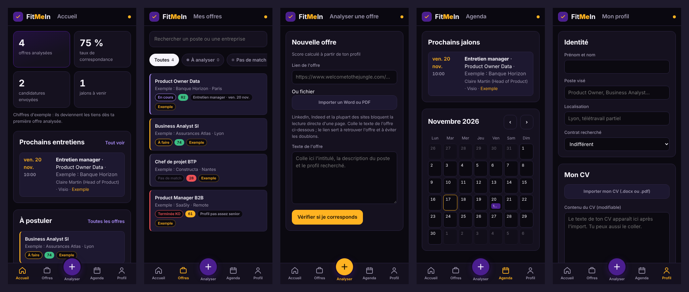

# FitMeIn

Vérifie en quelques secondes si une offre d'emploi correspond à ton profil, génère un CV optimisé ATS sans rien inventer, et suis toutes tes candidatures jusqu'à la réponse finale.



## Fonctionnalités

- **Profil** : import du CV (.docx / .pdf), compétences par domaine (32 domaines alignés sur les jobboards) avec un niveau de 1 à 4, pré-remplissage par IA.
- **Analyse d'offre** : lien, fichier Word/PDF ou texte collé. Score de 0 à 100 expliqué (couvert / un peu juste / manquant).
- **Anti-doublon** : URL normalisée, empreinte du texte et similarité (annonce republiée).
- **CV ATS** : rédaction par Claude, puis contrôle anti-invention (tout élément absent du profil est retiré) et export .docx une colonne.
- **Suivi** : 6 statuts (À analyser, Pas de match, À faire, En cours, Terminée OK, Terminée KO), jalons d'entretien, motif et date de refus.
- **Connecteur France Travail** (API officielle) ; LinkedIn, Indeed, HelloWork et WTTJ via extension navigateur (à venir).

## Architecture

```
apps/
  api/   FastAPI : IA (extraction, matching, CV), parsing, connecteurs
  web/   Next.js 14 + Tailwind : app mobile-first (barre d'onglets en bas), PWA
supabase/
  migrations/  schéma Postgres + RLS + stockage des CV
prototype/
  index.html   démo autonome (une page) utilisée pour tester le parcours
```

Le front lit et écrit les données directement dans Supabase (RLS : chacun ne voit que ses lignes). L'API ne porte que ce qui demande de l'IA ou des secrets, avec le JWT de l'utilisateur.

**Matching hybride** : le LLM qualifie chaque exigence de l'offre (obligatoire/souhaitée, couverte/partielle/manquante) via une sortie structurée validée par Pydantic ; le score est calculé en Python (60 % obligatoires, 20 % souhaitées, 20 % contexte) et couvert par des tests.

## Démarrer

1. Crée un projet Supabase, puis exécute `supabase/migrations/0001_init.sql` (SQL Editor).
2. API :
   ```bash
   cd apps/api
   cp .env.example .env   # remplis les clés
   pip install -r requirements.txt
   uvicorn app.main:app --reload
   pytest
   ```
3. Web :
   ```bash
   cd apps/web
   cp .env.example .env.local
   npm install
   npm run dev
   ```
   Ouvre http://localhost:3000.

## Roadmap

- [ ] Extension navigateur « Capturer cette offre »
- [ ] App mobile Expo (partage depuis LinkedIn / Indeed)
- [ ] Référentiel complet ROME 4.0 / ESCO
- [ ] Rappels d'entretien et export .ics
- [ ] Lecture des emails (statuts et jalons automatiques)
- [ ] Jeu d'évaluation du matching (30 couples offre / profil annotés)
